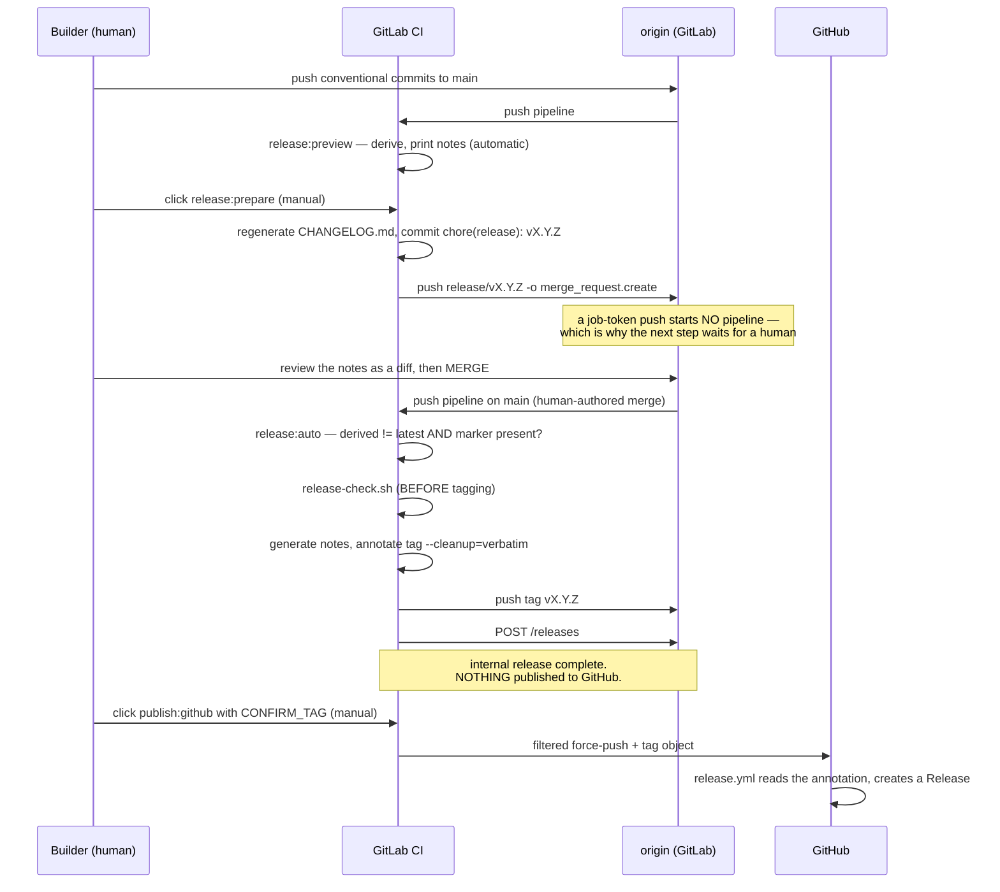

# Releasing

How to cut a release of the IPA framework. The version is **derived** from Conventional Commit history — there is nothing to type and no file to bump.

## TL;DR

```
1. Click the "release:prepare" job on the pipeline for main.
   -> it opens a merge request containing the regenerated CHANGELOG.md

2. Read the notes in that merge request. Merge it.
   -> merging tags the release and creates the GitLab Release, automatically
```

That is the whole internal flow. Two steps, one of them a button. **Merging is the approval** — there is no confirmation after it, and a tag cannot be cleanly retracted, so read the notes before merging rather than after.

Publishing to the public GitHub mirror is a **separate** act that is not part of this flow. See [Publishing to GitHub](#publishing-to-github).

## Prerequisites

- Push access to `main` on GitLab
- The `release:prepare` job needs the project setting *Allow Git push requests to this project's repository*, and `release/*` must be unprotected. See [Release Prerequisites](release-prerequisites.md) for what has been verified and what has not.
- **`git-cliff`** installed locally, only if you want to preview or regenerate `CHANGELOG.md` by hand — `brew install git-cliff`. CI installs its own pinned copy.

## The Jobs

The job names are the documentation. All of them run on a **branch** pipeline for `main`.

### Normal flow

| Job | Trigger | What it does | What it creates |
|-----|---------|--------------|-----------------|
| `release:prepare` | Manual | Regenerates `CHANGELOG.md` on a `release/vX.Y.Z` branch and opens a merge request | A branch and an MR. **No tag.** |
| `release:auto` | **Automatic**, every push to `main` | Tags and creates the GitLab Release when a release MR was merged. Does nothing on any other push. | A tag and a GitLab Release — or nothing |

### Supporting

| Job | Trigger | What it does |
|-----|---------|--------------|
| `release:preview` | **Automatic**, every push to `main` | Prints the derived version and the exact notes. Creates nothing. Non-blocking. |
| `release:prepare:major` | Manual, `CONFIRM_VERSION`-gated | The reviewed route to a major version — same flow, still no tag. |

### Break-glass

Not the normal path. These tag directly, with no review, and exist because the automatic path can fail for reasons unrelated to the release being correct — a runner outage, a transient API failure, `ash` unavailable. A release process with no manual override blocks on its own infrastructure.

| Job | Trigger | What it does |
|-----|---------|--------------|
| `release` | Manual | Derives, asserts, tags `origin`, creates a GitLab Release. No review. |
| `release:major` | Manual, `CONFIRM_VERSION`-gated | The same, forcing a major bump. |

All four release paths call `infra/scripts/release-run.sh`, so they cannot drift from one another — and its absence-on-origin assertion means **no two of them can ever create the same tag**, in either order.

### release:prepare

Derives the version, regenerates `CHANGELOG.md` over the `CHANGELOG_FLOOR` range, commits it as `chore(release): vX.Y.Z` on `release/vX.Y.Z`, and pushes with merge-request-creating push options.

It creates **no tag**, and says so in its own output. It is safe to run twice: a second run with identical content reports the branch as already prepared and exits successfully.

When nothing since the newest tag affects the version, it exits **successfully** having created nothing. That is not a failure — it is the answer to "is there anything to release?"

:::note If the merge request is not created
A job-token push may not honour MR-creating push options on every GitLab instance. The job handles this: the branch is still pushed and the output prints the URL for opening the merge request by hand. One click, no lost work, no new credential.
:::

### release:auto

Runs on every push to `main`, and its usual outcome is to do nothing.

It releases only when **both** conditions hold:

1. the derived version differs from the newest tag, **and**
2. a `chore(release): ` commit is reachable since that tag.

Neither alone is sufficient. Condition 1 alone would tag on every ordinary feature merge. Condition 2 alone would re-tag a marker that was already released.

This pairing is why automatic tagging works now, having been tried and reverted in 2026-05: that attempt gated on `changes: [VERSION]`, so there was no way to merge to `main` for non-release purposes without either faking a release or losing one. Derivation supplies the semantic trigger a file-modification check could not.

**Why a commit marker rather than "was this MR a release MR?"** Every `CI_MERGE_REQUEST_*` variable requires an *open* merge request and a merge-request pipeline. After a merge, both conditions fail — this pipeline cannot see the merge request it came from. Testing the merge-commit subject and testing the parent count were both tried, and both fail under a squash merge. The marker works under both merge methods because `release-prepare.sh` makes the **merge request title** the marker, and GitLab defaults a squash commit's subject to the title.

:::warning Do not rename a release merge request
The title is the marker. Rename it and a squashed merge carries no marker, so the release silently does not fire — you get a merged MR and no tag.
:::

### release:preview

Runs on its own, so the answer to "what would a release look like right now?" is always already on screen. When nothing in the window affects the version it prints *nothing to release* and passes — a preview that failed on most pushes would be a preview everybody learned to ignore.

### release:prepare:major and release:major

While the project is pre-1.0, `cliff.toml` sets `breaking_always_bump_major = false`, so a `feat!:` commit derives `0.x+1` rather than `1.0.0`. Reaching a major version therefore requires one of the major jobs, and both require confirmation:

```
error: preparing a major release requires explicit confirmation
would prepare: v1.0.0
hint: re-run with CONFIRM_VERSION=v1.0.0
```

Run it once to learn the value, then re-run with that value supplied as a CI variable. It fails before creating anything.

Prefer `release:prepare:major` — it opens a merge request and creates no tag, so the irreversible act is still deferred to a reviewed merge.

:::note Post-1.0 behavior
`breaking_always_bump_major = false` is **inert** once the major reaches 1 — at `v1.0.0` a `feat!:` commit derives `v2.0.0` normally. After the 1.0 transition, ordinary derivation coins majors and the major-specific jobs become decorative. That is the correct semantic: past 1.0, a breaking change genuinely should mean a major, and `release:preview` is what keeps it from being a surprise.
:::

## Procedure: Cutting a Release

### Step 1: Land your work

Commit with Conventional Commit messages and push to `main`. The message format is what determines the version and the release notes — a non-conventional commit derives no bump and appears in no section.

### Step 2: Click release:prepare

Open the pipeline for your commit and run the `release:prepare` job. It prints the branch it created and the merge request it opened:

```
Preparing v0.3.0 (current: v0.2.0)

ok: committed chore(release): v0.3.0 on release/v0.3.0 (CHANGELOG.md only)
ok: pushed release/v0.3.0 to origin
ok: merge request: https://code.aws.dev/.../-/merge_requests/57

Prepared v0.3.0 for review.
  branch:  release/v0.3.0 (one commit, CHANGELOG.md only)
  NO TAG was created by this job, and nothing was published.
```

If it reports nothing to release, no commit in the window affects the version.

### Step 3: Review the notes

Open the merge request. The diff **is** the release notes. Ask:

- Are the entries accurate?
- Is the derived version right? A `feat:` gives a minor bump, a `fix:` a patch.
- Is anything missing? Work committed with a non-conventional subject is invisible here.

Do not hand-edit `CHANGELOG.md` to fix something. It is a generated file and the next release overwrites it. Change the **source**: amend the commit body to fix wording, or add an empty commit carrying the prose for a missing entry, then re-run `release:prepare`.

### Step 4: Merge

Merging tags the release. `release:auto` runs on the resulting pipeline for `main`, detects the marker, and creates the tag and the GitLab Release.

Either merge method works — merge commit or squash.

### Step 5: Verify

- [ ] The tag exists on GitLab
- [ ] A GitLab **Release object** exists for that tag, not just a bare tag
- [ ] The Release body carries the generated notes with headings intact
- [ ] Nothing changed on GitHub — publishing is separate

## Procedure: Hotfix on Main

1. Create a short-lived feature branch from `main`:
   ```bash
   git checkout -b fix/critical-bug main
   ```
2. Make the fix, commit with a `fix:` prefix
3. Open an MR targeting `main`, get review, merge
4. Follow the standard release procedure above — the `fix:` commit derives a patch bump

## Publishing to GitHub

Cutting an internal release and publishing to the public mirror are **separate acts**. Nothing in the internal flow pushes anything public.

| Job | Trigger | What it does |
|-----|---------|--------------|
| `publish:github:plan` | Manual | Prints the tag, the floor, the full notes body, the filtered-path report, and the `CONFIRM_TAG` value. Publishes nothing. |
| `publish:github` | Manual, gated | Publishes. Requires `CONFIRM_TAG`. The one irreversible act in the release path. |

:::note Publication cannot be automated off release:auto
A tag pushed by CI triggers **no pipeline** — GitLab documents this explicitly for job-token pushes. Chaining publication off the release tag would therefore fail silently: the tag appears, nothing happens, and no error is reported anywhere. Publication stays a deliberate manual act because that is the only shape that works.
:::

### Procedure

1. Run `publish:github:plan`. Set the `TAG` variable to publish something other than the newest internal tag; leave it unset for the newest.
2. Read its output — the notes body is exactly what the public Release will carry.
3. Run `publish:github` with `CONFIRM_TAG` set to the value the plan printed.

### Publishing an older tag

Supply `TAG=v0.3.0` to either job. Nothing is retagged internally: the internal tag already exists and is correct, and only the public side is brought forward. The operator's local tags are byte-identical before and after a publish run.

### What a gap in the public tag sequence means

The public tag sequence is allowed to be gapped — `v0.1.7` then `v0.4.0` with nothing between — and it carries a specific meaning worth being precise about.

**Publishing does not withhold code.** The publish path amends the tip and force-pushes `main`, so the code of a release you never published reaches the public repository the next time you publish anything. What is withheld is the **tag and the Release object**.

So a gap describes real, already-public code that no Release object documents. That is why the notes for a publish cover everything since the last publish rather than just the newest version: the release notes for `v0.4.0` published over a floor of `v0.1.7` contain a section per intervening version, so nothing that shipped goes undescribed.

The floor is resolved from GitHub itself — GitHub is the only authority on what GitHub already has, so there is no "last published" record to drift.

For the mechanisms and their hazards, see [`internal/release/README.md`](https://code.aws.dev/proserve/genaiid/other/candidate-reusable-assets/innovation-patterns/-/blob/main/internal/release/README.md).

## Troubleshooting

### I merged the release MR but no tag appeared

`release:auto` did not find its marker. The likely causes, in order:

1. **The merge request was renamed.** The title is the marker. Under a squash merge the commit subject comes from the title, so a renamed MR produces a commit with no `chore(release): ` subject.
2. **The changelog commit was dropped** during a rebase or an amend.
3. **The derived version already equals the newest tag** — the release was already cut.

**Fix:** read the `release:auto` job log. It states which condition failed and prints the range it searched. If the marker is genuinely absent, use the break-glass `release` job, or re-run `release:prepare` and merge the new MR.

### release:auto warns that CHANGELOG.md does not match

Expected, and it does **not** block the release. It means a commit landed on `main` while the release was under review, so the committed changelog no longer matches a fresh generation.

Nothing is wrong with the release. The notes attached to the tag are generated fresh from history at release time, so the **published** notes are complete and include the late commit. Only the committed file lags — and the whole file is regenerated at the next release, which recovers the missing entry in this version's section.

This assertion is advisory in the automatic path and a hard gate in the break-glass path. The asymmetry is deliberate: in the manual path the operator regenerated the changelog moments ago, so a mismatch means they got it wrong. In the automatic path it usually means somebody else merged something, which is ordinary team activity and not a release defect.

**Fix (optional):** reconcile it now with `make -f infra/scripts/release.mk release-changelog VERSION=<x.y.z>`, or leave it to self-heal.

### release-check fails: local tag disagrees with origin

Your clone has a tag pointing at a different commit than `origin`'s tag of the same name. Almost always caused by having run a mirror push, which force-moves tags locally by design.

**Fix:** the error prints it — `git fetch origin --tags --force`.

### release-check fails: tag does not match the derived version

You asked for a version that history does not derive. The error names both values.

**Fix:** release the derived version, or add the commits that would justify the one you wanted.

### release-check fails: CHANGELOG.md does not match what the tag will publish

In the break-glass path this is a hard failure. The committed `CHANGELOG.md` differs from a fresh generation for the tag being released, which means it was not regenerated for this release or it was hand-edited.

**Fix:** regenerate and commit it. The error prints the command:

```bash
make -f infra/scripts/release.mk release-changelog VERSION=0.3.0
git commit -am 'chore(release): v0.3.0'
```

Do not edit the file to make the diff go away — the next release regenerates the whole file and the edit is lost. To change the **wording** of an entry, amend the commit body. To add a **missing** entry, add an empty commit carrying the prose:

```bash
git commit --allow-empty -m 'feat(scope): subject' -m 'body...'
```

:::note A date difference is not what failed
The release date in a version heading is excluded from the comparison, so `## [0.3.0] - 2026-08-08` and `## [0.3.0] - 2026-08-11` compare equal. For an unreleased version git-cliff stamps the generation date, so the date carries no information until the tag exists — checking it would fail every release whose review crossed midnight. If the guard fired, look for a **content** or **version** difference in the diff it printed.
:::

### release:prepare cannot push the branch

The job-token push was refused. The error names the cause: the project setting *Allow Git push requests to this project's repository* (Settings → CI/CD → Job token permissions), which is off by default and requires Maintainer or Owner, or a protected-branch rule matching `release/*`.

See [Release Prerequisites](release-prerequisites.md) for the checks and the documented fallback.

### "Nothing to release"

No commit since the last tag affects the version. Most often every commit in the window is `chore:`, `test:`, `style:`, or `Update:`-shaped — all of which are configured to derive no bump.

**Fix:** if the work deserves a release, it deserves a conventional commit message. Nothing is wrong with the pipeline.

### A major job fails without creating anything

Expected — that is the gate. Read the `hint:` line, which names the exact `CONFIRM_VERSION` value, and re-run with it.

### The GitLab Release object is missing but the tag exists

The tag push succeeded and the Release API call failed. The tag is fine.

**Fix:** re-run the job, or call `infra/scripts/gitlab-release.sh <tag> <notes-file>` directly. It is idempotent — an existing Release is reported as success rather than an error.

### git-cliff not installed locally

Only the local `make` targets need it; CI installs its own.

```bash
brew install git-cliff
```

### Pipeline missing the manual buttons

The release jobs only appear on pipelines running on the default branch (`main`). Pipelines on feature branches do not show them, and neither do pipelines on a `release/*` branch.

## Background: Trunk-Based Workflow

The project uses **trunk-based development** on `main`. Daily work lands directly on `main` or via short-lived feature branches merged back to `main`. **There is no `develop` branch.**

Prior to v0.1.7, the project used a Gitflow-lite model: `develop` was the default branch, and releases required merging `develop` into `main`, then reconciling SHAs back. The trunk-based model eliminated that merge ceremony and SHA reconciliation overhead.

**A `release/vX.Y.Z` branch is not a return to that model,** and the distinction is worth stating precisely because the two are easily conflated:

- What was removed was a **long-lived parallel branch** — `develop` existed permanently alongside `main`, and every release meant reconciling two histories.
- What the release flow adds is an **ephemeral branch per version** — it carries one machine-authored commit, lives only for the duration of one review, and is deleted on merge. There is no second permanent line of development, and no reconciliation.

The release branch exists for exactly one reason: a merge request is the only way to review generated release notes as a diff before a tag exists. It is a review artifact, not a development branch.

## Background: Version Derivation

There is **no `VERSION` file**. It was retired because it conflated two different questions — "what is the next version?" (a release-time derivation) and "what is the current version?" (a build-time display) — and because being hand-maintained, it was routinely wrong: it read `0.1.8` while the newest tag was `v0.1.7` and no `v0.1.8` ever existed.

Tags are the single source of truth. `git-cliff --bumped-version` answers the first question; `git describe` answers the second.

Two configured behaviors matter when reading a derivation:

- **`Update:`-prefixed commits are skipped entirely.** They affect neither the version nor any changelog section. A batch of these predates the convention.
- **A breaking change stays within `0.x` while pre-1.0.** See the major jobs above.

### git-cliff

[git-cliff](https://git-cliff.org/) generates the CHANGELOG from git history by parsing Conventional Commit messages, and derives the next version from the same history. Configuration is `cliff.toml` at the repo root.

CI installs a pinned `git-cliff==2.10.1` — the version every mechanism in the release path was verified against.

### Conventional Commits

See the public [Commit Messages](../../../../developer-docs/contributing/commit-messages.md) reference for the full type/scope table. Quick reference:

| Type | CHANGELOG Section |
|------|-------------------|
| `feat` | Added |
| `fix` | Fixed |
| `docs` | Documentation |
| `perf` | Performance |
| `refactor` | Changed |
| `ci`, `build` | CI/Build |
| `revert` | Reverted |
| `style`, `test`, `chore`, `Update:` | (skipped) |

The release ceremony is invisible to the changelog by design: `chore(release):` subjects, merge commits, and squash subjects all produce no notes output, under either merge method.

## Reference: Scripts

### infra/scripts/release.mk

| Target | What it does |
|--------|--------------|
| `release-preview` | Prints the derived version and notes. Creates nothing. The local counterpart of `release:preview`. |
| `release-prepare` | Cuts `release/vX.Y.Z` with a regenerated `CHANGELOG.md` and opens a merge request. The local counterpart of `release:prepare`. |
| `release-changelog` | Regenerates `CHANGELOG.md` through the derived version |
| `release-prep` | Regenerates `CHANGELOG.md` in the working tree for **inspection**. Not the release flow — use `release-prepare`. |
| `release-check` | Runs the three release assertions |

All of them derive `VERSION` by default. Override explicitly when you need to: `VERSION=0.3.0`.

### infra/scripts/release-prepare.sh

Prepares a release for review: derives the version, regenerates `CHANGELOG.md` on `release/vX.Y.Z`, commits it as `chore(release): vX.Y.Z`, and pushes with MR-creating push options. Creates no tag. Idempotent. Pushes only to `release/*` — never to `main`, on any path.

### infra/scripts/release-run.sh

The release act itself, called by all four release jobs so they cannot drift: derive, assert absent on `origin`, run `release-check.sh` **before** tagging, generate notes, tag with `--cleanup=verbatim -F`, push the tag, create the GitLab Release.

`--cleanup=verbatim -F` is load-bearing rather than stylistic. The public side (`.github/workflows/release.yml`) reads the tag annotation and requires it to contain `## [` headings; the default cleanup mode strips comment-looking lines and reflows content, and `verbatim` also preserves the two-space nested indentation `cliff.toml` produces.

### infra/scripts/release-check.sh

Three assertions:

1. **Tag hygiene** — every local release tag must point at the same commit as `origin`'s tag of the same name. This is a reachable state, not a hypothetical: the mirror push amends the release commit and force-moves the tag locally, so any clone that has run a release carries the disagreement. A disagreeing tag poisons both version derivation and any publish range.
2. **Derived matches requested** — the tag about to be created must equal what history derives.
3. **`CHANGELOG.md` matches the generated output** — the committed file is compared against a fresh generation for the tag being released. The **release date** in a version heading is excluded, because for an unreleased version git-cliff stamps the generation date and it cannot be meaningfully verified before the tag exists.

All three run **before** the tag is created, so a failure leaves no wrong tag behind.

Assertions 1 and 2 are hard in every path. Assertion 3 honours `ADVISORY_CHANGELOG=1`, which `release:auto` sets — see the troubleshooting entry above for why.

### infra/scripts/changelog-lib.sh

Holds `CHANGELOG_FLOOR` and the single `git-cliff` invocation that generates the changelog. Sourced by `release-check.sh` and `release-prepare.sh`, and read by `release.mk`, so what one path *writes* cannot drift from what another path *verifies*.

`CHANGELOG_FLOOR` is the cutover: everything after it is generated from history, everything at or before it is frozen text in `cliff.toml`'s `footer`. Conventional Commits were adopted in v0.1.6, so generating across that boundary drops v0.1.1 entirely and reduces v0.1.3 to a bare heading.

## Reference: CI Variables

### CONFIRM_VERSION

Supplied at job-run time to `release:prepare:major` and `release:major` only. Not a stored variable — run the job once, read the value from the failure message, re-run with it.

### CONFIRM_TAG

Supplied at job-run time to `publish:github` only. Run `publish:github:plan` first to learn the value.

### GITHUB_DEPLOY_KEY

An SSH private key with push access to `github.com:aws-samples/sample-innovation-patterns`. Used only by the **publishing** jobs, not by any internal release job.

**Setup steps:**

1. Generate an SSH keypair:
   ```bash
   ssh-keygen -t ed25519 -C "gitlab-ci-deploy" -f deploy_key -N ""
   ```

2. Add the **public key** to GitHub:
   - Go to `github.com/aws-samples/sample-innovation-patterns` → Settings → Deploy Keys
   - Add `deploy_key.pub` with **write access** enabled

3. Base64-encode the private key (GitLab rejects masking for values containing whitespace/newlines):
   ```bash
   base64 -i deploy_key | tr -d '\n'
   ```

4. Add it to GitLab under Settings → CI/CD → Variables:
   - Key: `GITHUB_DEPLOY_KEY`
   - Value: the base64 string from step 3
   - Flags: **Masked**, **Protected**

5. Delete the local keypair:
   ```bash
   rm deploy_key deploy_key.pub
   ```

The CI job decodes it at runtime: `printf '%s' "$GITHUB_DEPLOY_KEY" | base64 -di | ssh-add -`.

## Reference: Release Flow Diagram



## Migration History

v0.1.6 was the last release under the develop → main merge flow. Starting with v0.1.7, the project uses trunk-based development on `main`.

Before the three-job revision, one manual `tag-and-release` job read the `VERSION` file, tagged, and mirrored to GitHub in consecutive lines of a single script — so an internal release could not be cut without also publishing publicly, and an older tag could not be published at all.

Before the merge-request flow, cutting a release was a single button press that tagged `origin` immediately, with no review of the notes and no enforcement that `CHANGELOG.md` had been regenerated. That is what produced v0.2.0, whose committed changelog read `## [Unreleased]` while the tag and the published Release both said 0.2.0. The changelog step was documented as *optional*; it is now the merge request.
