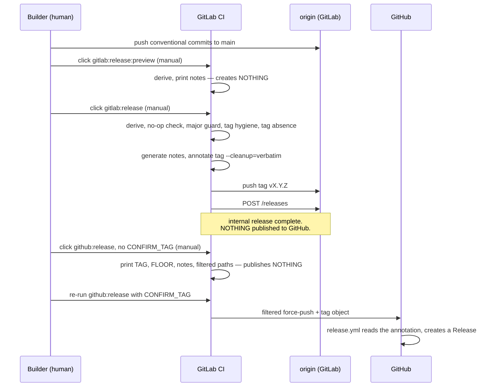

# Releasing

How to cut a release of the IPA framework. The version is **derived** from Conventional Commit history — there is nothing to type and no file to bump. Release notes live on the annotated tag and the GitLab Release object; there is no committed changelog.

## TL;DR

```
1. Click "gitlab:release:preview" on the pipeline for main.
   -> prints the version that would be cut and the exact notes. Creates nothing.

2. Click "gitlab:release".
   -> tags origin and creates the GitLab Release

3. (Optional, separate) Click "github:release" to publish to the public mirror.
   -> the FIRST click is a dry run. Re-run it with the CONFIRM_TAG it prints.
```

Step 1 is a **voluntary pre-flight, not a gate** — nothing stops you clicking `gitlab:release` without it. There is no pre-tag review of the notes; see [The trade this flow makes](#the-trade-this-flow-makes).

Publishing to the public GitHub mirror is a **separate** act that is not part of cutting an internal release. See [Publishing to GitHub](#publishing-to-github).

## Prerequisites

- Push access to `main` on GitLab.
- `GITHUB_DEPLOY_KEY` as a masked, protected CI variable — **only** for publishing. No internal release job touches it. See [GITHUB_DEPLOY_KEY](#github_deploy_key).
- **`git-cliff`** installed locally, only if you want to preview from a workstation — `brew install git-cliff`. CI installs its own pinned copy.

:::note No project setting is required
Nothing in the release path pushes a **branch** any more, so the *Allow Git push requests to this project's repository* setting (Settings → CI/CD → Job token permissions) is **not** needed, and no `release/*` branch has to be left unprotected. The only ref any release job writes is the tag.
:::

## The Jobs

The job names are the documentation. All three run on a **branch** pipeline for `main`, and all three are **manual**.

| Job | What it does | What it creates | What it does NOT create |
|-----|--------------|-----------------|--------------------------|
| `gitlab:release:preview` | Prints the current tag, the version that would be cut, and the exact notes body | Nothing | No tag, no branch, no Release object |
| `gitlab:release` | Derives, asserts, tags `origin`, creates the GitLab Release | An annotated tag and a GitLab Release | Nothing on GitHub |
| `github:release` | Publishes a chosen tag to the public mirror with cumulative notes. **First run is a dry run** | With `CONFIRM_TAG`: a filtered public tree, a public tag, and a GitHub Release | Without `CONFIRM_TAG`: nothing at all |

Both `gitlab:*` jobs call `infra/scripts/release.sh`, so the preview cannot report notes that differ from what a release publishes. Its absence-on-origin assertion means repeated clicks cannot double-tag.

`gitlab:release:preview` is `allow_failure: true` — it creates nothing, so a failure is informational. `gitlab:release` is not: it creates something irreversible, so a failure is loud.

Clicking `gitlab:release` when there is nothing to release exits **successfully** having created nothing — see [the troubleshooting entry](#nothing-happened).

## Procedure: Cutting a Release

### Step 1: Land your work

Commit with Conventional Commit messages and push to `main`. The message format is what determines the version and the notes — a non-conventional commit derives no bump and appears in no section.

### Step 2: Click gitlab:release:preview

Read the notes it prints. Ask:

- Are the entries accurate?
- Is the derived version right? A `feat:` gives a minor bump, a `fix:` a patch.
- Is anything missing? Work committed with a non-conventional subject is invisible here.

To fix wording, amend the commit body — prose lives in commit bodies, which `cliff.toml` renders as indented continuation text under each bullet. To add a missing entry, add an empty commit carrying the prose:

```bash
git commit --allow-empty -m 'feat(scope): subject' -m 'body...'
```

### Step 3: Click gitlab:release

It derives, runs every assertion **before** creating anything, then tags `origin` and creates the GitLab Release.

### Step 4: Verify

- [ ] The tag exists on GitLab
- [ ] A GitLab **Release object** exists for that tag, not just a bare tag
- [ ] The Release body carries the generated notes with `## [` headings intact
- [ ] Nothing changed on GitHub — publishing is separate

## Procedure: Hotfix on Main

1. Create a short-lived feature branch from `main`:
   ```bash
   git checkout -b fix/critical-bug main
   ```
2. Make the fix, commit with a `fix:` prefix
3. Open an MR targeting `main`, get review, merge
4. Follow the standard release procedure above — the `fix:` commit derives a patch bump

## Publishing to GitHub

Cutting an internal release and publishing to the public mirror are **separate acts**. Nothing in the internal flow pushes anything public.

There is one job, and **its first run publishes nothing**:

| Run | Effect |
|-----|--------|
| `github:release` with no `CONFIRM_TAG` | Prints `TAG`, `FLOOR`, the full notes body, and the filtered-path report. Publishes nothing. Ends with `hint: re-run with CONFIRM_TAG=<tag>` |
| `github:release` with `CONFIRM_TAG=<tag>` | Publishes. The one irreversible act in the release path — it force-pushes a public repository that has accepted pull requests |

:::note Publication cannot be automated off a release
A tag pushed by CI triggers **no pipeline** — GitLab documents this explicitly for job-token pushes. Chaining publication off the release tag would therefore fail silently: the tag appears, nothing happens, and no error is reported anywhere. Publication stays a deliberate manual act because that is the only shape that works.
:::

### Procedure

1. Run `github:release`. Set the `TAG` variable to publish something other than the newest internal tag; leave it unset for the newest.
2. Read its output — the notes body is exactly what the public Release will carry.
3. Re-run `github:release` with `CONFIRM_TAG` set to the value it printed.

### Publishing an older tag

Supply `TAG=v0.3.0`. Nothing is retagged internally: the internal tag already exists and is correct, and only the public side is brought forward. The operator's local tags are byte-identical before and after a publish run — the publish path writes no local ref at all.

### What a gap in the public tag sequence means

The public tag sequence is allowed to be gapped — `v0.1.7` then `v0.4.0` with nothing between — and it carries a specific meaning worth being precise about.

**Publishing does not withhold code.** The publish path amends the tip and force-pushes `main`, so the code of a release you never published reaches the public repository the next time you publish anything. What is withheld is the **tag and the Release object**.

So a gap describes real, already-public code that no Release object documents. That is why the notes for a publish cover everything since the last publish rather than just the newest version: the notes for `v0.4.0` published over a floor of `v0.1.7` contain a section per intervening version, so nothing that shipped goes undescribed.

The floor is resolved from GitHub itself — GitHub is the only authority on what GitHub already has, so there is no "last published" record to drift.

For the mechanisms and their hazards, see [`internal/release/README.md`](https://code.aws.dev/proserve/genaiid/other/candidate-reusable-assets/innovation-patterns/-/blob/main/internal/release/README.md).

## The trade this flow makes

**There is no pre-tag review of the release notes.** Earlier the notes reached `main` as a committed `CHANGELOG.md` on a release branch behind a merge request, and that diff was the review gate. Retiring the committed changelog retired the gate with it.

What that gate was added for cannot recur: at `v0.2.0` the committed changelog still read `## [Unreleased]` while the tag and the Release both said 0.2.0. A file that does not exist cannot go stale relative to its tag, so the incident class is structurally impossible now rather than merely guarded against.

What is genuinely lost is a *blocking* look at the notes before a tag exists. `gitlab:release:preview` replaces it with a voluntary one.

**Commit-message adherence is now the single point of failure.** With no changelog to review, a non-conventional commit is invisible: it derives no bump and appears in no notes section, and there is no artifact in which anyone would notice. Adherence has been measured at 27%, 17%, and 33% in past samples. There is no commitlint job — the convention is advisory, and this is the risk that carries.

## Troubleshooting

### I clicked gitlab:release and nothing happened {#nothing-happened}

The job went **green** and created nothing. That is the no-op, and it is the most likely confusing outcome — a green job is easier to miss than a red one. Read the log: it names the tag it compared against.

The usual cause is that every commit since the last tag is `chore:`, `test:`, `style:`, or `Update:`-shaped, all of which are configured to derive no bump.

**Fix:** if the work deserves a release, it deserves a conventional commit message. Nothing is wrong with the pipeline.

### I clicked github:release and it published nothing

That is the dry run, and it is what the first click always does. The log ends with the exact value to re-run with:

```
hint: re-run with CONFIRM_TAG=v0.2.1
```

Re-run the job with that variable set. Everything above that line in the log is what a real publish would do.

### The release fails: local tag disagrees with origin

Your clone has a tag pointing at a different commit than `origin`'s tag of the same name. Almost always caused by having run a mirror push under an older implementation, which force-moved tags locally.

A disagreeing tag is not cosmetic: `git describe` returns the wrong base, so the version derives from the wrong place and nothing complains. That is why this is asserted rather than trusted.

**Fix:** the error prints it — `git fetch origin --tags --force`.

### The release fails: tag exists locally but NOT on origin

A previous run created the tag and failed before pushing it, so that release was never published. The error offers both recoveries: push the existing tag and create its Release object, or delete the local tag and start over.

### A release is refused because it changes the MAJOR version

Expected — that is the gate. Read the `hint:` line, which names the exact value:

```
error: this release changes the MAJOR version (v0.9.3 -> v1.0.0)
hint: re-run with CONFIRM_VERSION=v1.0.0
```

Re-run with that value supplied as a CI variable. It fails before creating anything, and the value must match the derived tag exactly — so if history moves in between, the stale value stops working rather than releasing the wrong version.

### The GitLab Release object is missing but the tag exists

The tag push succeeded and the Release API call failed. The tag is fine.

**Fix:** re-run the job, or call `infra/scripts/gitlab-release.sh <tag> <notes-file>` directly. It is idempotent — an existing Release is reported as success rather than an error.

### git-cliff not installed locally

Only the local `make` targets need it; CI installs its own pinned copy.

```bash
brew install git-cliff
```

### Pipeline missing the manual buttons

The release jobs only appear on pipelines running on the default branch (`main`). Pipelines on feature branches do not show them.

## Background: Trunk-Based Workflow

The project uses **trunk-based development** on `main`. Daily work lands directly on `main` or via short-lived feature branches merged back to `main`. **There is no `develop` branch**, and the release path creates no branch of its own.

v0.1.6 was the last release cut under the earlier Gitflow-lite model, where `develop` was the default branch and every release meant merging `develop` into `main` and reconciling SHAs back.

## Background: Version Derivation

There is **no `VERSION` file**. It was retired because it conflated two different questions — "what is the next version?" (a release-time derivation) and "what is the current version?" (a build-time display) — and because being hand-maintained, it was routinely wrong: it read `0.1.8` while the newest tag was `v0.1.7` and no `v0.1.8` ever existed.

Tags are the single source of truth. `git-cliff --bumped-version` answers the first question; `git describe` answers the second.

Three configured behaviors matter when reading a derivation:

- **`Update:`-prefixed commits are skipped entirely.** They affect neither the version nor any notes section. A batch of these predates the convention.
- **Only strict `vX.Y.Z` tags are eligible as a derivation base.** `cliff.toml`'s `tag_pattern` enforces it, so a stray prerelease-shaped tag like `v0.9.9-rc1` cannot become the base.
- **A breaking change stays within `0.x` while pre-1.0.** `cliff.toml` sets `breaking_always_bump_major = false`, so a `feat!:` commit derives `0.x+1` rather than `1.0.0`. This setting is **inert** once the major reaches 1 — at `v1.0.0` a `feat!:` derives `v2.0.0` normally. The guard that survives the 1.0 transition is the version-shape check in `release.sh`, which refuses any release raising the major unless `CONFIRM_VERSION` matches.

### git-cliff

[git-cliff](https://git-cliff.org/) generates the notes from git history by parsing Conventional Commit messages, and derives the next version from the same history. Configuration is `cliff.toml` at the repo root.

CI installs a pinned `git-cliff==2.10.1` — the version every mechanism in the release path was verified against.

### Conventional Commits

See the public [Commit Messages](../../../../developer-docs/contributing/commit-messages.md) reference for the full type/scope table. Quick reference:

| Type | Release notes section |
|------|-----------------------|
| `feat` | Added |
| `fix` | Fixed |
| `docs` | Documentation |
| `perf` | Performance |
| `refactor` | Changed |
| `ci`, `build` | CI/Build |
| `revert` | Reverted |
| `style`, `test`, `chore`, `Update:` | (skipped) |

## Reference: Scripts

### infra/scripts/release.sh

The whole release act, in one script, called by both `gitlab:*` jobs and runnable from a workstation. It takes **no arguments** — the version is derived, not requested.

**The ordering is the design.** Everything that can refuse runs before the tag exists, because a gate that fires after tagging is not a gate:

1. **Derive** with `git-cliff --bumped-version`.
2. **Preview** (`PREVIEW=1`) — returns first, so it needs no network and cannot report notes a release would not publish.
3. **No-op** — exits 0 when the derived version equals the newest tag, but only once `origin` confirms that tag was actually pushed.
4. **Major guard** — refuses unless `CONFIRM_VERSION` equals the derived tag.
5. **Tag hygiene** — every local release tag must match `origin`'s tag of the same name.
6. **Tag absence** — refuses if the tag exists locally or on `origin`. This is the double-tag guard.
7. **Notes**, asserting the output contains a `^## \[` heading.
8. **Tag, push, Release object.**

`--cleanup=verbatim -F` on the tag is **load-bearing rather than stylistic**. Git's default cleanup mode strips `#`-leading lines as comments and reflows content — and exits 0 while doing it, so the loss is silent. The public side (`.github/workflows/release.yml`) reads this annotation and requires `## [` headings. `verbatim` also preserves the two-space nested indentation `cliff.toml` produces, which is why its `trim = false` is mandatory for the same reason.

### infra/scripts/gitlab-release.sh

Creates the GitLab Release object for an existing tag, via the REST API with `CI_JOB_TOKEN`. Kept as a separate script because it is the recovery path when the tag pushed but the Release object failed — it is idempotent, reporting an existing Release as success.

The REST API rather than the `release:` CI keyword: that keyword needs `release-cli`, a Go binary absent from the `python:3.12-bookworm` image the release jobs use for `git-cliff`.

### infra/scripts/release.mk

| Target | What it does |
|--------|--------------|
| `release-preview` | Delegates to `PREVIEW=1 release.sh`. Creates nothing. The local counterpart of `gitlab:release:preview`. |
| `release` | Delegates to `release.sh`. **Tags and pushes for real** — the recovery path when CI is unavailable. |

Both delegate rather than reimplement, so a local run and a CI run cannot disagree.

:::note Why manual jobs on a branch pipeline rather than tag-triggered
A tag pipeline cannot work here. `pages` requires `$CI_COMMIT_BRANCH`, which is unset on tag pipelines, and the release jobs require `$CI_COMMIT_TAG == null`. A manual job on a branch pipeline sidesteps both.
:::

## Reference: CI Variables

### CONFIRM_VERSION

Supplied at job-run time to `gitlab:release`, and only needed when the release raises the **major** version. Not a stored variable — run the job once, read the value from the failure message, re-run with it. It must equal the derived tag exactly.

### CONFIRM_TAG

Supplied at job-run time to `github:release`. Its **absence is the dry run**, so run the job once and read the value out of its output.

### GITHUB_DEPLOY_KEY

An SSH private key with push access to `github.com:aws-samples/sample-innovation-patterns`. Used only by `github:release`, not by any internal release job.

**Setup steps:**

1. Generate an SSH keypair:
   ```bash
   ssh-keygen -t ed25519 -C "gitlab-ci-deploy" -f deploy_key -N ""
   ```

2. Add the **public key** to GitHub:
   - Go to `github.com/aws-samples/sample-innovation-patterns` → Settings → Deploy Keys
   - Add `deploy_key.pub` with **write access** enabled

3. Base64-encode the private key (GitLab rejects masking for values containing whitespace/newlines):
   ```bash
   base64 -i deploy_key | tr -d '\n'
   ```

4. Add it to GitLab under Settings → CI/CD → Variables:
   - Key: `GITHUB_DEPLOY_KEY`
   - Value: the base64 string from step 3
   - Flags: **Masked**, **Protected**

5. Delete the local keypair:
   ```bash
   rm deploy_key deploy_key.pub
   ```

The CI job decodes it at runtime: `printf '%s' "$GITHUB_DEPLOY_KEY" | base64 -di | ssh-add -`. A 350-byte floor on the decoded length catches a truncated or mis-pasted value before `ssh-add` fails with something less obvious.

## Reference: Release Flow Diagram



## Migration History

**Current era — tag-only releases.** The committed `CHANGELOG.md` was retired, and with it the ephemeral release branch, the release merge request, the marker commit subject the automatic tagger keyed on, the tag-on-merge job itself, and the separate major-release jobs. Notes live on the annotated tag and the Release object. Six internal jobs and two publish jobs became three manual buttons. The v0.2.0 failure mode is structurally impossible now: no committed file exists to go stale.

**Before that**, a release was prepared as a merge request carrying a regenerated changelog, reviewed as a diff, and tagged automatically when merged — the merge was the approval. All of that machinery existed to police the committed changelog, which is what made retiring the file able to retire the flow.

**Before that**, cutting a release was a single button press that tagged `origin` immediately, with no review of the notes and no enforcement that the changelog had been regenerated. That is what produced v0.2.0, whose committed changelog read `## [Unreleased]` while the tag and the published Release both said 0.2.0.

**Before that**, one manual job read the `VERSION` file, tagged, and mirrored to GitHub in consecutive lines of a single script — so an internal release could not be cut without also publishing publicly, and an older tag could not be published at all.

v0.1.6 was the last release under the develop → main merge flow. Starting with v0.1.7, the project uses trunk-based development on `main`.
